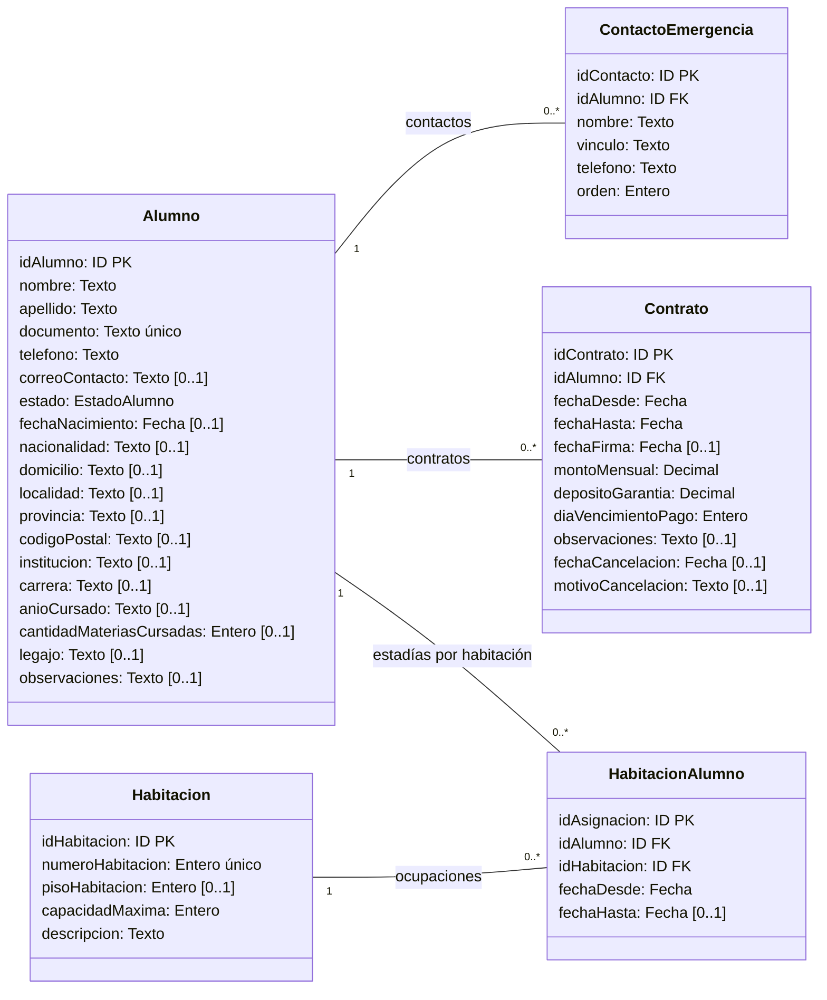
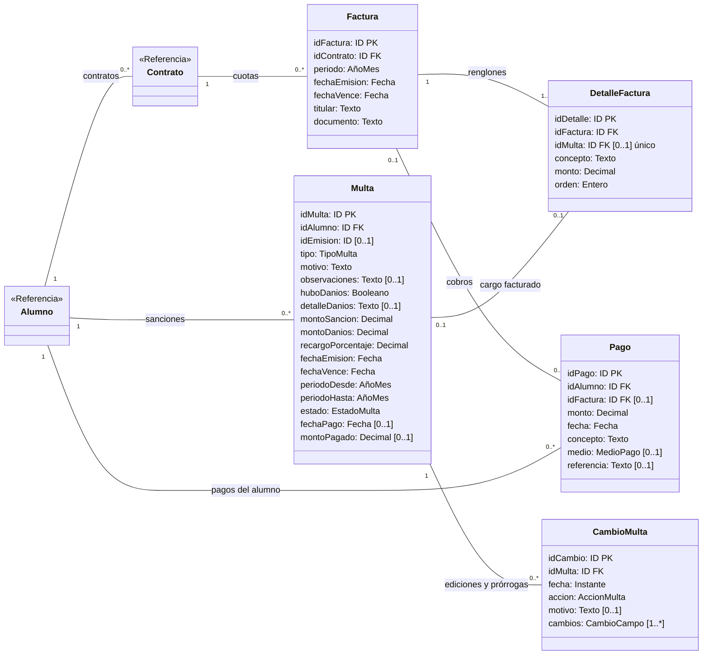
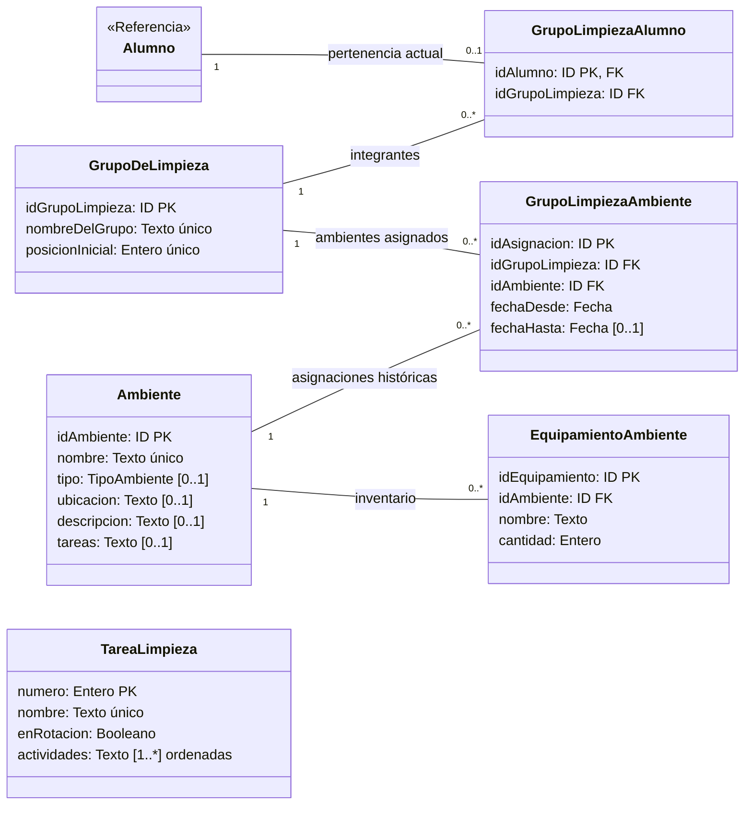
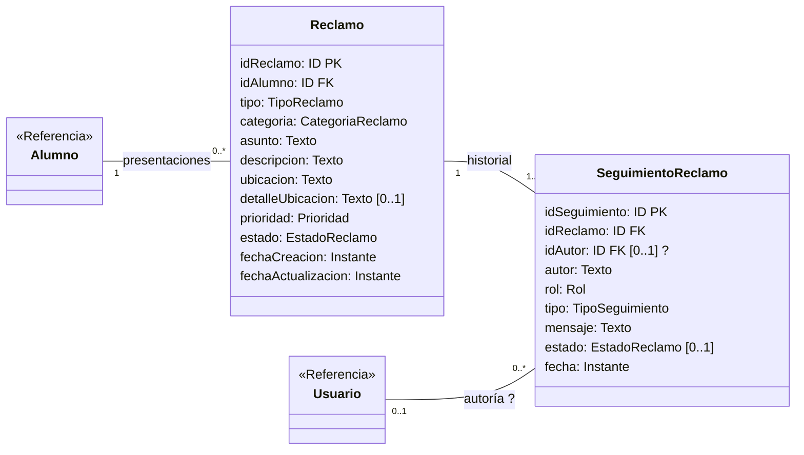
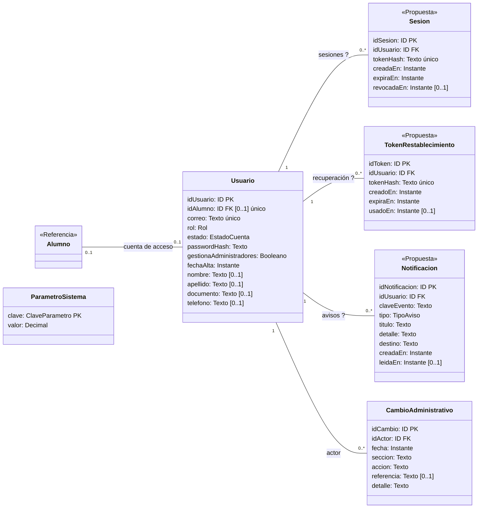

# Gestión de Residencia · Modelo de datos del backend

Propuesta de **24 clases** a partir de las pantallas activas y las reglas del frontend. Las cinco vistas UML forman un solo modelo. Las cajas «Referencia» remiten a una clase definida en otra vista. Entre comillas en cada extremo de una relación figura su multiplicidad. Los campos sin multiplicidad explícita son obligatorios. `PK` indica clave primaria y `FK` indica clave foránea. El signo `?` identifica las propuestas de persistencia para funciones que necesitan soporte del servidor.

Los identificadores son opacos. `Decimal` usa precisión fija para importes en ARS y porcentajes. `Fecha` es un día calendario, `AñoMes` representa un período mensual e `Instante` guarda fecha y hora. Las vigencias se calculan con la fecha de negocio de la residencia. Ocupación, saldo, estado de factura, estado de contrato, próxima factura, rotación y totales del panel se obtienen de los registros relacionados.

## Alojamiento

- **Alumno y contactos.** Normalizar el documento para garantizar unicidad. La ficha conserva un correo de contacto opcional. El alta actual exige fecha de nacimiento anterior a hoy, domicilio, localidad, provincia, carrera y cantidad de materias cursadas. Se conservan como opcionales en el modelo para admitir datos anteriores. Al importar, convertir los campos de emergencia sueltos en contactos cuando no exista ya la lista.
- **Contrato.** La fecha de fin pactada es inclusiva. La baja se hace efectiva al comenzar `fechaCancelacion` y conserva el fin pactado y el motivo. Impedir contratos superpuestos por alumno usando el fin efectivo. Renovación, reingreso y vigencia se calculan con las fechas y el historial. Copiar al contrato la cuota, el depósito y el día de vencimiento acordados.
- **Habitación.** Número positivo y único. Capacidad positiva. Cada asignación conserva el intervalo `[fechaDesde, fechaHasta)`. Un fin vacío indica que sigue abierta. Impedir dos asignaciones simultáneas para el mismo alumno y superar el cupo de la habitación. Al cambiar de habitación, cerrar la anterior y abrir la nueva en una transacción. La baja de contrato cierra o recorta las asignaciones afectadas en la misma operación.

## Facturación, cobros y multas

- **Emisión.** Una factura por `(idContrato, periodo)`. Emitir una cuota completa si el mes tiene al menos un día de estadía efectiva y el período no es futuro. Si el día pactado supera la duración del mes, usar el último día. Guardar titular, documento y renglones como quedaron al emitir. El titular vivo se obtiene a través de `Factura → Contrato → Alumno`.
- **Cobro.** Los cobros nuevos requieren factura. El vínculo opcional conserva pagos históricos sin factura. Cuando hay factura, el alumno del pago debe ser el titular del contrato. Validar monto positivo, fecha entre emisión y hoy, y referencia obligatoria para transferencia o tarjeta. Validar el saldo y registrar el pago en la misma transacción. El total es la suma de los renglones. El saldo es el total menos los cobros. El estado de factura se calcula con saldo, pagos y fecha de vencimiento.
- **Multa.** La emisión múltiple crea una multa por alumno y las agrupa con `idEmision`. Guardar sanción, daños y porcentaje de recargo aplicados. El importe base se deriva de sanción más daños. Cada multa puede entrar en un solo renglón de factura. Ese renglón congela el importe con el recargo que corresponda al emitir. Una multa facturada queda bloqueada para edición, prórroga, anulación y cobro directo. Cuando se salda la factura se registran fecha e importe pagado de sus multas. Una multa pendiente sin factura admite regularización directa, reflejada en la propia multa.
- **Historial.** `CambioCampo` contiene `campo`, `anterior` y `nuevo`. Guardar la edición o prórroga con estos valores y el motivo de prórroga. Al importar multas antiguas con solo el monto base, recuperar los componentes a partir del monto histórico y los daños disponibles.
- **Valores.** MedioPago admite `efectivo`, `transferencia` y `tarjeta`. TipoMulta admite `leve`, `moderada`, `grave` y `extraordinaria`. EstadoMulta admite `pendiente`, `pagada` y `anulada`. La marca visual «vencida» se deriva de la fecha. AccionMulta admite `edicion` y `prorroga`.

## Limpieza y ambientes

- **Integrantes.** Un alumno puede estar en cero o un grupo a la vez. `GrupoLimpiezaAlumno` usa `idAlumno` como clave para garantizarlo. Al crear un grupo se exige al menos un integrante activo. El prototipo admite hasta cuatro grupos y posiciones iniciales del 1 al 4, sin repetir.
- **Rotación.** `posicionInicial` representa el campo `tareaInicial` del frontend. Es un desplazamiento en la lista ordenada de tareas activas. La tarea semanal se calcula a partir de esa posición, las tareas en rotación y el bloque del mes (días 1–7, 8–14 y así sucesivamente). Usar el orden de `numero` como orden estable de las tareas. Cada tarea tiene al menos una actividad, en el orden ingresado.
- **Ambientes.** Cada ambiente puede pasar por distintos grupos y tener a lo sumo una asignación en una fecha dada. Guardar intervalos con fin exclusivo y validar solapamientos. El inventario guarda una cantidad entera positiva por nombre de equipo normalizado y ambiente. La descripción y las tareas del ambiente son texto.
- **Valores.** TipoAmbiente admite Sala de estudio, Baño, Cocina, Duchas, Comedor, Lavadero y Otro. Se admite un tipo vacío para los ambientes históricos. Las habitaciones se gestionan en Alojamiento.

## Reclamos y solicitudes

- **Ubicación.** Guardar la etiqueta visible al presentar el caso. Puede corresponder a la habitación vigente del alumno, a un ambiente común o a una ubicación general. Así, el traslado del alumno o el cambio de nombre del ambiente conserva el texto original.
- **Seguimiento.** Crear el reclamo en estado `pendiente` con su primer evento. Registrar respuestas, cambios de estado y fecha de actualización en la misma transacción. El historial guarda nombre y rol del autor al momento del evento. Se propone guardar también `idAutor` en eventos nuevos y permitir que quede vacío en eventos anteriores cuya autoría no pueda vincularse.
- **Permisos.** Cada alumno accede a sus propios casos. Puede comentar casos abiertos o cancelar los propios. Administración puede responder y cambiar el estado a pendiente, en revisión, resuelto o rechazado. Los casos cerrados conservan el historial.
- **Valores.** TipoReclamo admite `reclamo`, `solicitud` y `problema`. CategoriaReclamo admite `mantenimiento`, `limpieza`, `convivencia`, `administracion` y `otro`. Prioridad admite `normal` y `alta`. EstadoReclamo admite `pendiente`, `en_revision`, `resuelto`, `rechazado` y `cancelado`. TipoSeguimiento admite `creacion`, `comentario` y `estado`.

## Acceso, avisos y administración

- **Identidad y acceso.** `Alumno` es el expediente de residencia. `Usuario` es la cuenta y puede existir por separado para administración. Para rol alumno se exige el vínculo a un único expediente y se leen de allí nombre, apellido, documento y teléfono. Para rol administrador se guardan los datos de perfil en `Usuario`. El correo de acceso se normaliza, es único y puede inicializarse con el correo de contacto. La cuenta del alumno requiere un contrato vigente para habilitar el acceso. `gestionaAdministradores` aplica a administradores autorizados.
- **Sesión y recuperación.** Se proponen sesiones revocables con vencimiento y un token de restablecimiento por solicitud, con vigencia y uso único. Guardar hashes de credenciales y tokens en el servidor. La recuperación y la activación se implementan con enlaces de un solo uso o un flujo equivalente. Para importar cuentas de demostración, requerir una nueva contraseña mediante ese flujo.
- **Avisos.** Se propone persistir el contenido y la lectura por cuenta. Usar una clave de evento estable (por ejemplo, el identificador del seguimiento de reclamo) y garantizar unicidad de `(idUsuario, claveEvento)`. Los avisos cubren facturas pendientes o vencidas, multas, vencimiento de contrato, asignaciones pendientes y novedades de reclamos.
- **Auditoría.** `CambioAdministrativo` registra el actor, la sección, la operación y la referencia al registro afectado cuando existe. Escribir el evento junto con el cambio de negocio y excluir credenciales y tokens del detalle.
- **Parámetros.** Una fila por clave. Las claves actuales son `multaLeve`, `multaModerada`, `multaGrave`, `recargoMulta`, `cuotaMensual`, `deposito`, `diaVencimiento` y `duracionContrato`. Los valores sirven de predeterminados para nuevas operaciones. Validar sus rangos según el catálogo del frontend.
- **Valores.** Rol admite `administrador` y `alumno`. EstadoCuenta admite `pendiente`, `activo`, `suspendido` e `inactivo`. EstadoAlumno admite `activo` e `inactivo`.

## Fuentes del proyecto

- [Rutas activas](../Frontend/app/routes.ts) y [revisión de pantallas](../Frontend/REVISION-PANTALLAS.md).
- [Tipos persistidos](../Frontend/app/lib/types.ts) y [operaciones del store](../Frontend/app/lib/store.tsx).
- [Alojamiento](../Frontend/app/lib/gestiones.ts), [dominio y rotación](../Frontend/app/lib/domain.ts), [facturación](../Frontend/app/lib/facturacion.ts) y [multas](../Frontend/app/lib/multas.ts).
- [Reclamos](../Frontend/app/lib/reclamos.ts), [cuentas y auditoría](../Frontend/app/lib/administracion.ts), [parámetros](../Frontend/app/lib/parametros.ts) y [avisos del portal](../Frontend/app/lib/portal-alumno.ts).
